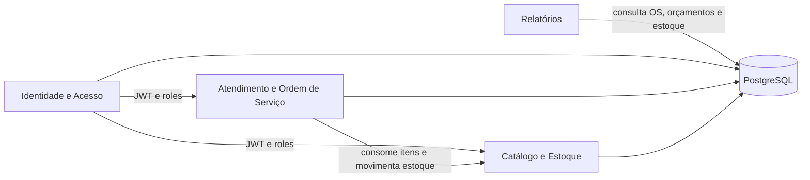
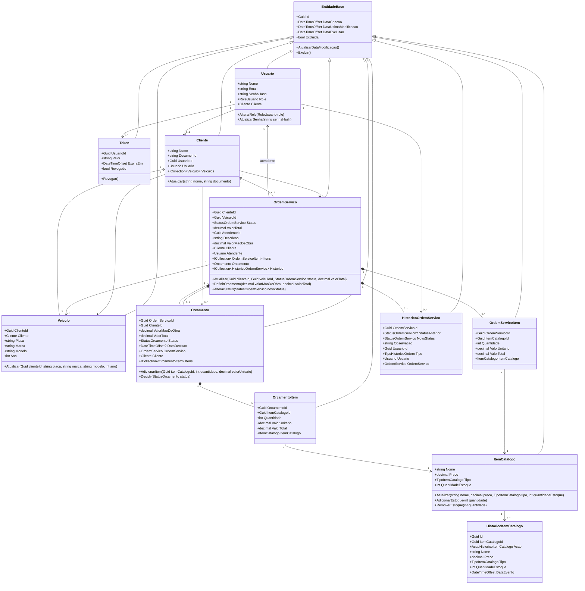
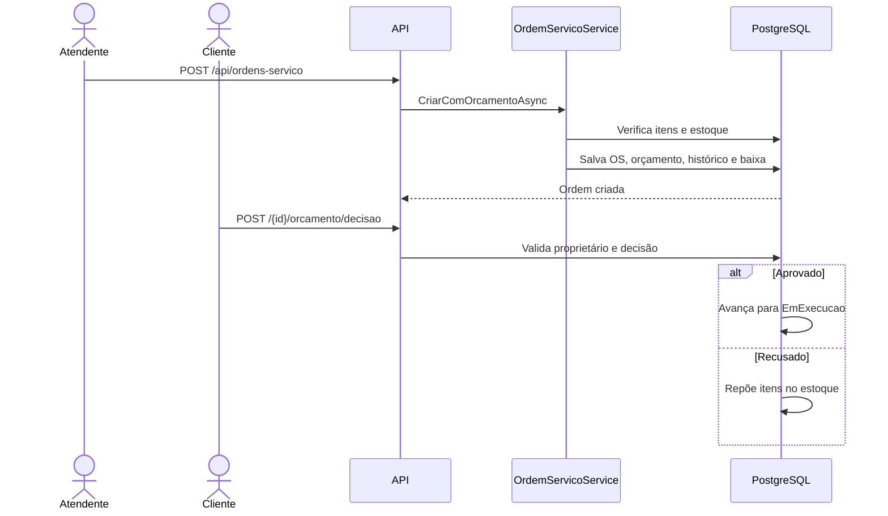
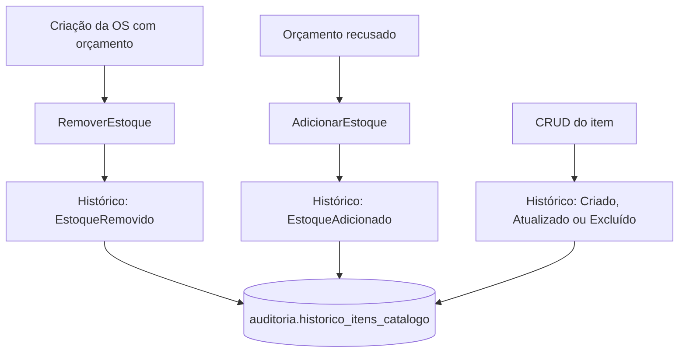

# Diagramas de domínio

Os diagramas abaixo representam o código atual. Os arquivos `.mmd` são fontes Mermaid editáveis.

## Context Map

Fonte: [context-map.mmd](./diagramas/context-map.mmd).

## Agregados e entidades

Fonte: [agregados.mmd](./diagramas/agregados.mmd).

## Fluxo de ordem e orçamento

Fonte: [fluxo-ordem-servico.mmd](./diagramas/fluxo-ordem-servico.mmd).

## Estoque e auditoria

Fonte: [estoque-auditoria.mmd](./diagramas/estoque-auditoria.mmd).

## Relação com a implementação

| Conceito | Componentes |
|---|---|
| Entrada HTTP | Controllers em `src/Oficina.Application/Controllers` |
| Caso de uso | Services em `src/Oficina.Application/Services` |
| Estado do domínio | Entidades em `src/Oficina.Domain/Entities` |
| Persistência | Repositories em `src/Oficina.Infra.Data/Repositories` |
| Mapeamento | `src/Oficina.Infra.Data/Mappings` |
| Banco e migrations | `src/Oficina.Infra.Data.Postgres/Migrations` |
| Testes | `tests/Oficina.Application.Tests` |
